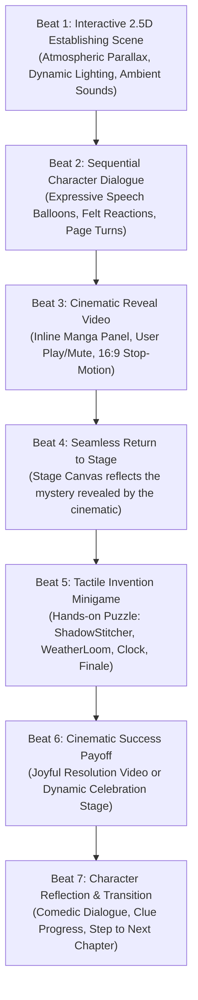

# MORROW — CINEMATIC PRODUCTION EXPANSION & 2.5D INTERACTIVE DIRECTIVE
## Loops 10 & 11 Combined Production Plan · 4,000 Google Flow Credit Allocation · Master 48-Shot Cinematic Bible

---

## 1. Executive Vision: Cinematic 2.5D Stop-Motion Adventure

MORROW transforms into a **cinematic 2.5D interactive adventure** that marries tactile handmade stop-motion animation (Google Veo / Flow) with accessible, touch-first in-engine browser mechanics.

Every chapter follows an unbreakable **7-Beat Narrative & Gameplay Loop**:

---

## 2. Resource & Flow Credit Strategy (~4,000 Credits Across 4 Accounts)

We manage **~4,000 Google Flow credits** across 4 distributed production accounts (~1,000 credits/account). Each Veo generation incurs model costs; credits must be allocated strategically.

### Credit Allocation Tiering:
1. **Tier 1: Essential Character & Climax Shots (Generate First — ~2,400 credits)**
   - High-acting character performances that require realistic fabric physics, blinking button eyes, and stop-motion acting (e.g. Morrow waking, Duck tree-shadow reveal, Professor Perfect porcelain conflict, Finale crooked knot stitch).
2. **Tier 2: Key Story Reveals & Payoffs (Generate Second — ~1,200 credits)**
   - Major comedic and narrative payoff moments (e.g. Inverted rain in Weather Forest, gears unfreezing in Tomorrow Town, Epilogue tea party).
3. **Tier 3: In-Engine 2.5D Procedural Fallbacks (Preserve Credits — 0 credits)**
   - Establishing environmental pans, dialog reaction shots, and atmospheric transitions that can be rendered **more reliably, faster, and with higher resolution** using CSS/SVG 2.5D perspective parallax and Web Audio synthesis.
   - **Rule:** If an in-engine SVG animation provides sharper rendering, zero load latency, and superior touch interaction, do NOT waste Veo credits on a static camera video.

---

## 3. Master 48-Shot Cinematic Breakdown (All 6 Chapters)

Below is the exhaustive, shot-by-shot specification across all six chapters (8 shots per chapter = 48 total shots).

---

### CHAPTER 0: PROLOGUE — THE WORKSHOP (Shots 01–08)

#### Shot PR-01: Waking on the Workbench
- **ID:** `PROLOGUE-01` | **Filename:** `morrow-waking.mp4` / `morrow-waking-poster.jpg`
- **Characters & Canonical Reference:** Morrow (Approved Felt Turnaround: peach felt body, asymmetric ears, plum scarf, gold diamond stitch, button eyes, spool tail).
- **Camera:** Intimate eye-level dolly pushing in slowly from wide workbench to medium close-up of Morrow's sleeping basket.
- **Action & Dialogue:** 0–2s: Morrow sleeps curled up in wool basket, chest breathing, one ear twitching. 2–4s: Brass bell sounds in distance; button eyes blink open; left ear perks while right flops. 4–6s: Stands up, stumbles on plum scarf, knocks golden spool of thread. 6–8s: Golden thread floats into a glowing star; Morrow smiles shyly at camera.
- **Duration & Aspect Ratio:** 8.0s | 16:9 Landscape (1280x720)
- **Visual States:** Starts in soft dawn darkness -> Ends in warm morning lantern glow.
- **Sound:** Soft bell toll, fabric rustle, wooden spool thud, gentle crystalline chime.
- **Delivery Strategy:** **Real Video (Tier 1 — Approved & In Repo).**

#### Shot PR-02: The Resonating Bell
- **ID:** `PROLOGUE-02` | **Filename:** `prologue-02-giant.mp4` / `prologue-02-giant-poster.jpg`
- **Characters:** Workshop environment & Sir Clack's suspended brass bell.
- **Camera:** Static low-angle looking up at the polished brass bell vibrating with acoustic shockwaves.
- **Action & Dialogue:** Bell swings with immense resonance: "DING!" Dust motes scatter. Outside the workshop window, a towering silhouette stirs in the morning mist.
- **Duration & Aspect Ratio:** 6.0s | 16:9 Landscape
- **Visual States:** Still brass bell -> Shaking bell with expanding sound ripples.
- **Sound:** Deep, resonant, reverberant brass gong.
- **Delivery Strategy:** **Real Video (Tier 1 — In Repo).**

#### Shot PR-03: Sir Clack's Diagnosis
- **ID:** `PROLOGUE-03` | **Filename:** `prologue-03-clack-visitor.mp4` / `prologue-03-clack-visitor-poster.jpg`
- **Characters:** Sir Clack (Weathered mahogany toolbox with brass latches and unimpressed wooden brow) & Morrow.
- **Camera:** Medium two-shot at workbench level.
- **Action & Dialogue:** Sir Clack snaps open his twin latches, wooden brow furrowing. Morrow cowers behind a thimble. Dialogue: *"That is a visitor, you walnut."*
- **Duration & Aspect Ratio:** 6.5s | 16:9 Landscape
- **Visual States:** Morrow hiding -> Clack glaring toward window -> Morrow peeking out.
- **Sound:** Wooden creak, brass latch snap, grumpy wooden mutter.
- **Delivery Strategy:** **Real Video (Tier 1 — In Repo).**

#### Shot PR-04: Morrow's Polite Greeting
- **ID:** `PROLOGUE-04` | **Filename:** `prologue-04-morrow-hello.mp4` / `prologue-04-morrow-hello-poster.jpg`
- **Characters:** Morrow.
- **Camera:** Over-the-shoulder looking past Morrow's plum scarf toward the window.
- **Action & Dialogue:** Morrow waves a tiny mitten paw politely, ears bobbing with gentle curiosity. Dialogue: *"Hello, potentially polite giant!"*
- **Duration & Aspect Ratio:** 6.0s | 16:9 Landscape
- **Visual States:** Timid posture -> Warm, hopeful wave with scarf fluttering.
- **Sound:** Fabric swish, muffled outside footstep, soft hopeful chime.
- **Delivery Strategy:** **Real Video (Tier 1 — In Repo).**

#### Shot PR-05: Pipkin's Crash Landing
- **ID:** `PROLOGUE-05` | **Filename:** `prologue-05-pipkin-emergency.mp4` / `prologue-05-pipkin-emergency-poster.jpg`
- **Characters:** Pipkin (Tiny blue messenger bird with leather satchel and panicked round eyes).
- **Camera:** Fast tracking shot following a blue blur bursting through the workshop mail-slot.
- **Action & Dialogue:** Pipkin crash-lands on the workbench, scattering parchment and thread. Flaps wildly: *"EMERGENCY! THE WORLD IS BROKEN!"*
- **Duration & Aspect Ratio:** 7.0s | 16:9 Landscape
- **Visual States:** Empty workbench mail-slot -> Fluttering paper chaos with perched panicked bird.
- **Sound:** Mail flap clatter, wing fluttering, paper rustle, high-pitched chirp.
- **Delivery Strategy:** **Real Video (Tier 1 — In Repo).**

#### Shot PR-06: The Deadpan Inquiry
- **ID:** `PROLOGUE-06` | **Filename:** `prologue-06-clack-which-part.mp4` / `prologue-06-clack-which-part-poster.jpg`
- **Characters:** Sir Clack & Pipkin.
- **Camera:** Close-up on Sir Clack's deadpan wooden face.
- **Action & Dialogue:** Sir Clack slowly rotates his handle, unblinking. Dialogue: *"Which part?"*
- **Duration & Aspect Ratio:** 5.0s | 16:9 Landscape
- **Visual States:** Clack looking at scattered paper -> Eye contact with Pipkin.
- **Sound:** Slow wooden hinge creak, clock ticking in background.
- **Delivery Strategy:** **Real Video (Tier 1 — In Repo).**

#### Shot PR-07: The Comprehensive Answer
- **ID:** `PROLOGUE-07` | **Filename:** `prologue-07-pipkin-yes.mp4` / `prologue-07-pipkin-yes-poster.jpg`
- **Characters:** Pipkin.
- **Camera:** Extreme close-up on Pipkin's beak holding the special edition headline.
- **Action & Dialogue:** Pipkin bobs his head once with absolute, tragic certainty: *"Yes."*
- **Duration & Aspect Ratio:** 4.5s | 16:9 Landscape
- **Visual States:** Breathless pause -> Firm, urgent head nod.
- **Sound:** Single dramatic accordion chord / tiny feather ruffle.
- **Delivery Strategy:** **Real Video (Tier 1 — In Repo).**

#### Shot PR-08: Stepping into the World
- **ID:** `PROLOGUE-08` | **Filename:** `prologue-08-door-shadow.mp4` / `prologue-08-door-shadow-poster.jpg`
- **Characters:** Morrow, Sir Clack (carried in satchel), Pipkin on shoulder.
- **Camera:** Low-angle tracking shot moving from dim workshop interior through the arched wooden doorway into the bright golden world.
- **Action & Dialogue:** Morrow shoulders his repair needle and golden spool. The door swings open; on the ground outside, a strange tree-shaped shadow stretches across the path.
- **Duration & Aspect Ratio:** 8.0s | 16:9 Landscape
- **Visual States:** Dark workshop silhouette -> Golden sunlit meadow and cobblestones.
- **Sound:** Heavy wooden door creak, wind chimes, uplifting adventure horn motif.
- **Delivery Strategy:** **Real Video (Tier 1 — In Repo).**

---

### CHAPTER 1: LOST SHADOWS VILLAGE (Shots 09–16)

#### Shot SH-01: Arrival in the Twilight Village
- **ID:** `SHADOWS-01` | **Filename:** `shadows-01-arrival.mp4` (or in-engine 2.5D stage)
- **Characters:** Morrow & Sir Clack.
- **Camera:** Wide establishing pan across cobblestone alleyways, glowing amber lantern posts, and crooked timber cottages.
- **Action & Dialogue:** Morrow and Clack walk into the village square. Long, warped shadows stretch from buildings, but the street seems curiously disconnected from its residents.
- **Duration & Aspect Ratio:** 7.5s | 16:9 Landscape
- **Visual States:** Deep purple twilight vista -> Medium shot of cobblestones under Morrow's feet.
- **Sound:** Evening crickets, gentle cobblestone footfalls, distant chimney smoke crackle.
- **Delivery Strategy:** **In-Engine 2.5D Stage (Tier 3 — Superior responsive interactive canvas).**

#### Shot SH-02: Village Duck's Grievance (The Tree Shadow Reveal)
- **ID:** `SHADOWS-02` | **Filename:** `shadows-01-duck.mp4` / `shadows-01-duck-poster.jpg`
- **Characters:** Village Duck (White felt duck with mint knitted scarf, furrowed brow, orange feet).
- **Camera:** Medium shot focused on Duck waddling proudly down cobblestone street.
- **Action & Dialogue:** Duck waddles down street. Attached to its feet on the cobblestones is an enormous, towering gnarled oak tree shadow that rustles and sways. Duck stops, indignantly turns to Morrow: *"My shadow has been confiscated. Apparently I am too duck-shaped."*
- **Duration & Aspect Ratio:** 8.0s | 16:9 Landscape
- **Visual States:** Duck waddling -> Duck stopping and flapping wings toward tree shadow.
- **Sound:** Soft quack, rustling leaves from the shadow, cobblestone waddle steps.
- **Delivery Strategy:** **Real Video + Ground Projection Web Overlay (Tier 1 — Approved & In Repo).**

#### Shot SH-03: Sir Clack's Assessment
- **ID:** `SHADOWS-03` | **Filename:** `shadows-03-clack-ambition.mp4`
- **Characters:** Sir Clack & Morrow.
- **Camera:** Two-shot over Duck's shoulder looking at Morrow's tilted head.
- **Action & Dialogue:** Sir Clack mutters: *"An ambitious duck indeed."* Morrow points his golden needle toward Duck's feet, studying the seam where the shadow meets the feathers.
- **Duration & Aspect Ratio:** 5.0s | 16:9 Landscape
- **Visual States:** Morrow analyzing -> Needle glowing with faint golden light.
- **Sound:** Wooden creak, subtle needle chime.
- **Delivery Strategy:** **In-Engine Interactive Dialogue (Tier 3).**

#### Shot SH-04: Little Lantern's Mismatched Wish
- **ID:** `SHADOWS-04` | **Filename:** `shadows-04-lantern-wish.mp4`
- **Characters:** Little Lantern (Brass lantern post with flickering amber flame) & Wandering Snail.
- **Camera:** Low-angle close-up of a bronze lantern trembling by a garden wall.
- **Action & Dialogue:** Little Lantern weeps tiny sparks: *"I cast the shadow of a boot! I wanted to be a star in the night sky."* Beside it, a tiny snail casts a shadow shaped like a duck.
- **Duration & Aspect Ratio:** 6.0s | 16:9 Landscape
- **Visual States:** Boot shadow flickering -> Star spark glow in lantern glass.
- **Sound:** Glass clinking, fire crackle, tiny snail slide.
- **Delivery Strategy:** **Flow Generation (Tier 2).**

#### Shot SH-05: Morrow Threads the Golden Needle
- **ID:** `SHADOWS-05` | **Filename:** `shadows-05-needle-thread.mp4`
- **Characters:** Morrow's mitten paws, wooden spool tail, brass needle.
- **Camera:** Extreme tactile close-up on peach felt paws carefully passing glowing golden thread through the eye of a polished brass needle.
- **Action & Dialogue:** Morrow licks his mitten thumb, aligns the thread, pulls it taut. A warm golden spark emits from the eye.
- **Duration & Aspect Ratio:** 5.5s | 16:9 Landscape
- **Visual States:** Loose frayed thread -> Threaded needle glowing bright gold.
- **Sound:** Tactile thread sliding through brass, resonant magical hum.
- **Delivery Strategy:** **Flow Generation (Tier 1).**

#### Shot SH-06: The Shadow Stitcher Minigame Payoff
- **ID:** `SHADOWS-06` | **Filename:** `shadows-06-stitch-payoff.mp4`
- **Characters:** Duck, Little Lantern, Wandering Snail, Morrow.
- **Camera:** Dynamic circular tracking shot around the village fountain as three golden stitches cinch tight.
- **Action & Dialogue:** The tree shadow anchors securely to Duck's feet; Duck flaps wings and puffs chest with pride: *"I AM A FOREST!"* Lantern's star shadow radiates golden light across the wall. Snail happily waddles in its duck-shaped shadow.
- **Duration & Aspect Ratio:** 8.0s | 16:9 Landscape
- **Visual States:** Disjointed shadows -> Golden stitches flare -> Three joyful residents with their dream shadows.
- **Sound:** Magical stitch cinch, happy quack, lantern chime, celebratory accordion cheer.
- **Delivery Strategy:** **Flow Generation (Tier 1 — Core Payoff).**

#### Shot SH-07: The Distant Mystery Clue
- **ID:** `SHADOWS-07` | **Filename:** `shadows-07-mystery-shadow.mp4`
- **Characters:** The Unfinished One (Silhouetted in alleyway) & Sir Clack.
- **Camera:** Deep focus down a narrow cobblestone alley.
- **Action & Dialogue:** Amidst the celebration, a tiny navy felt figure with glowing golden eyes slips past a lantern, catching a loose thread trailing from Duck's shadow. It glances back at Morrow before vanishing into the forest.
- **Duration & Aspect Ratio:** 6.5s | 16:9 Landscape
- **Visual States:** Bright square celebration -> Mysterious dark alley reveal -> Figure departs.
- **Sound:** Subtle mystery chord, thread pull sound, distant wind chimes.
- **Delivery Strategy:** **Flow Generation (Tier 2).**

#### Shot SH-08: Transition to Weather Forest
- **ID:** `SHADOWS-08` | **Filename:** `shadows-08-forest-path.mp4`
- **Characters:** Morrow, Sir Clack, Pipkin.
- **Camera:** Tracking shot moving up the winding mountain path where trees begin to grow upside down.
- **Action & Dialogue:** Pipkin flutters ahead, pointing with his satchel: *"The forest is that way! Hold onto your hats—the rain is falling upward!"* Morrow clutches his plum scarf.
- **Duration & Aspect Ratio:** 7.0s | 16:9 Landscape
- **Visual States:** Cobblestone road -> Twisted forest canopy with rising raindrops.
- **Sound:** Wind swelling, upside-down water droplet plinks, Pipkin flutter.
- **Delivery Strategy:** **In-Engine 2.5D Stage Transition (Tier 3).**

---

### CHAPTER 2: THE UPSIDE-DOWN FOREST (Shots 17–24)

#### Shot WF-01: Inverted Canopy Panorama
- **ID:** `WEATHER-01` | **Filename:** `weather-01-canopy-pan.mp4`
- **Characters:** Forest environment, inverted birch and spruce trees.
- **Camera:** Slow tilt up into the sky where massive mossy tree roots anchor into the clouds and pine needles hang downward.
- **Action & Dialogue:** Giant pine cones dangle like chandeliers. Mist drifts upward from the ground. Raindrops bead on moss and accelerate toward the sky.
- **Duration & Aspect Ratio:** 7.5s | 16:9 Landscape
- **Visual States:** Forest floor -> Breathtaking inverted canopy stretching into the heavens.
- **Sound:** Atmospheric forest drone, reversed water droplet sounds, soft wood creaks.
- **Delivery Strategy:** **In-Engine 2.5D Stage (Tier 3).**

#### Shot WF-02: The Frog Mayor's Dilemma
- **ID:** `WEATHER-02` | **Filename:** `weather-02-frog-mayor.mp4`
- **Characters:** Frog Mayor (Emerald felt frog in plum tailcoat with oversized brass pocket watch and inverted leaf umbrella) & Pipkin.
- **Camera:** Medium shot of Frog Mayor perched precariously on a mossy log.
- **Action & Dialogue:** Frog Mayor opens an inverted leaf umbrella to collect rain; the umbrella fills like a soup bowl, tips over, and dumps water onto his crooked top hat. He croaks in despair: *"The lilies are thirsty! The clouds are drinking our ponds!"*
- **Duration & Aspect Ratio:** 8.0s | 16:9 Landscape
- **Visual States:** Proud frog pose -> Overturned umbrella puddle -> Indignant croak.
- **Sound:** Frog croak, comical water splash, squelchy hat squeeze.
- **Delivery Strategy:** **Flow Generation (Tier 1 — Character Acting).**

#### Shot WF-03: Pipkin's Urgent Dispatch
- **ID:** `WEATHER-03` | **Filename:** `weather-03-pipkin-dispatch.mp4`
- **Characters:** Pipkin & Morrow.
- **Camera:** Close-up on Pipkin perched upside down on an inverted twig.
- **Action & Dialogue:** Pipkin unfurls the Daily Panic: *"BREAKING NEWS: LOCAL CLOUD REFUSES GRAVITY!"* Morrow tilts his head 90 degrees to read the newspaper right-side-up.
- **Duration & Aspect Ratio:** 5.5s | 16:9 Landscape
- **Visual States:** Upside-down bird -> Morrow tilting neck with floppy ear hanging.
- **Sound:** Paper rustle, chirping urgency, comical neck stretch sound.
- **Delivery Strategy:** **In-Engine Dialogue (Tier 3).**

#### Shot WF-04: The Weather Loom Discovery
- **ID:** `WEATHER-04` | **Filename:** `weather-04-loom-reveal.mp4`
- **Characters:** Morrow & Sir Clack.
- **Camera:** Low-angle push-in toward an ancient carved wooden loom standing by a crystal pool.
- **Action & Dialogue:** Three giant spools of weather thread are tangled in thorny vines: Cobalt Rain, Sky Blue Wind, and Golden Sunbeam. The warp threads vibrate wildly out of pitch.
- **Duration & Aspect Ratio:** 6.5s | 16:9 Landscape
- **Visual States:** Overgrown loom in shadows -> Morrow brushing vines away -> Spools glowing in primary colors.
- **Sound:** Twanging out-of-tune loom strings, mystical hum.
- **Delivery Strategy:** **Flow Generation (Tier 2).**

#### Shot WF-05: Weaving the Weather
- **ID:** `WEATHER-05` | **Filename:** `weather-05-weaving-threads.mp4`
- **Characters:** Morrow's mitten paws, shuttle, weather thread.
- **Camera:** Rapid macro montage of weaving action.
- **Action & Dialogue:** Morrow throws the wooden shuttle; cobalt rain thread weaves into silver cloud warp; golden sunbeam thread ties into green meadow weave. Sparkles scatter with every pass of the shuttle.
- **Duration & Aspect Ratio:** 7.0s | 16:9 Landscape
- **Visual States:** Tangled loom -> Fast rhythmical shuttle passes -> Harmonious woven weather tapestry.
- **Sound:** Rhythmic wooden loom clack, thread whirring, musical chords ascending.
- **Delivery Strategy:** **Flow Generation (Tier 1).**

#### Shot WF-06: The Weather Restored (Payoff)
- **ID:** `WEATHER-06` | **Filename:** `weather-06-weather-payoff.mp4`
- **Characters:** Frog Mayor, Thirsty Lilies, Windmill, Morrow.
- **Camera:** Sweeping 180-degree crane shot as the weather rights itself.
- **Action & Dialogue:** Gentle rain begins falling downward; thirsty lilies open with pink and white petals, drinking greedily. The distant windmill catches sky-blue wind and spins gracefully. Frog Mayor adjusts his hat, smiles warmly, and bows deeply to Morrow.
- **Duration & Aspect Ratio:** 8.0s | 16:9 Landscape
- **Visual States:** Chaotic upside-down storm -> Peaceful, sun-drenched pastoral harmony.
- **Sound:** Gentle downward rain on leaves, windmill creaking happily, frog contented croak, uplifting flute melody.
- **Delivery Strategy:** **Flow Generation (Tier 1 — Core Payoff).**

#### Shot WF-07: The Frog Mayor's Gift
- **ID:** `WEATHER-07` | **Filename:** `weather-07-clockwork-gift.mp4`
- **Characters:** Frog Mayor & Morrow.
- **Camera:** Medium close-up on Frog Mayor opening a polished brass locket.
- **Action & Dialogue:** Frog Mayor presents a coiled brass spring: the **Weather Spring**. *"Take this to Tomorrow Town, little Stitchling. You will need it before the clock runs out."*
- **Duration & Aspect Ratio:** 6.0s | 16:9 Landscape
- **Visual States:** Locket opening -> Morrow receiving the glowing spring into his satchel.
- **Sound:** Locket click, brass spring chime, warm orchestral harmony.
- **Delivery Strategy:** **Flow Generation (Tier 2).**

#### Shot WF-08: Toward Tomorrow Town
- **ID:** `WEATHER-08` | **Filename:** `weather-08-tomorrow-road.mp4`
- **Characters:** Morrow & Sir Clack.
- **Camera:** Wide shot looking down a cobblestone causeway toward a colossal brass clock tower looming against a purple twilight sky.
- **Action & Dialogue:** The hands of the clock tower are visibly frozen. Steam vents are locked mid-burst. Sir Clack grumbles: *"The paperwork must be dreadful."*
- **Duration & Aspect Ratio:** 7.0s | 16:9 Landscape
- **Visual States:** Lush green forest edge -> Steampunk brass and stone architecture frozen in time.
- **Sound:** Muffled brass ticking that suddenly stutters and dies, cold wind whisper.
- **Delivery Strategy:** **In-Engine 2.5D Stage Transition (Tier 3).**

---

### CHAPTER 3: TOMORROW TOWN (Shots 25–32)

#### Shot TT-01: The Frozen Town Square
- **ID:** `CLOCK-01` | **Filename:** `clock-01-frozen-square.mp4`
- **Characters:** Town environment, frozen townspeople (baker, postman, child with hoop).
- **Camera:** Slow lateral dolly past frozen miniature townspeople cast in stone and wax stillness.
- **Action & Dialogue:** A baker holds flour midair in frozen suspension. A flying pigeon hangs motionless beside a brass lamppost. Morrow walks among them, his plum scarf the only moving color.
- **Duration & Aspect Ratio:** 7.5s | 16:9 Landscape
- **Visual States:** Completely motionless sepia town -> Morrow's peach felt body walking past camera.
- **Sound:** Deep eerie mechanical silence, hollow wind, Morrow's soft footsteps.
- **Delivery Strategy:** **Flow Generation (Tier 1 — Cinematic Atmosphere).**

#### Shot TT-02: Professor Perfect's Entrance
- **ID:** `CLOCK-02` | **Filename:** `clock-02-perfect-entrance.mp4`
- **Characters:** Professor Primrose Perfect (Tall elegant porcelain administrator in lilac coat with hairline gold cracks) & Morrow.
- **Camera:** Low-angle tracking shot as enormous brass gears part to reveal Professor Perfect on her inspection podium.
- **Action & Dialogue:** Professor Perfect descends with rigid, metronome-like steps. Her porcelain head turns with clockwork precision. She holds a heavy bronze rejection stamp: *"Tomorrow is delayed. Irregularities detected. Standards must be upheld."*
- **Duration & Aspect Ratio:** 8.0s | 16:9 Landscape
- **Visual States:** Dark mechanism -> Parting gears -> Professor Perfect standing under harsh inspection spotlight.
- **Sound:** Heavy gear grinding, sharp metallic footsteps, chilling mechanical click.
- **Delivery Strategy:** **Flow Generation (Tier 1 — Character Introduction).**

#### Shot TT-03: The Flawed Porcelain Cheek
- **ID:** `CLOCK-03` | **Filename:** `clock-03-porcelain-crack.mp4`
- **Characters:** Professor Perfect.
- **Camera:** Extreme close-up on Professor Perfect's porcelain cheek and round brass spectacles.
- **Action & Dialogue:** A glint of light catches her cheek, revealing a web of delicate golden hairline cracks—repaired imperfections she hides behind rigid posture. Her fingers tremble slightly against her clipboard.
- **Duration & Aspect Ratio:** 5.5s | 16:9 Landscape
- **Visual States:** Severe emotionless expression -> Vulnerable flicker of realization in eye.
- **Sound:** Faint porcelain stress creak, hollow heartbeat tick.
- **Delivery Strategy:** **Flow Generation (Tier 1).**

#### Shot TT-04: The Missing Gear Sockets
- **ID:** `CLOCK-04` | **Filename:** `clock-04-gear-sockets.mp4`
- **Characters:** Morrow, Sir Clack, Clock mechanism.
- **Camera:** Medium shot inspecting the colossal clock tower movement face.
- **Action & Dialogue:** Three large gear sockets sit vacant and scarred: the Shadow Socket, the Weather Socket, and the central Heart Socket. Tangled loose threads prevent the escapement wheel from turning.
- **Duration & Aspect Ratio:** 6.0s | 16:9 Landscape
- **Visual States:** Jammed brass mechanism -> Morrow shining golden thread lantern into the sockets.
- **Sound:** Metal scrape, hollow echo, Sir Clack tool rattling.
- **Delivery Strategy:** **In-Engine 2.5D Stage (Tier 3).**

#### Shot TT-05: Inserting the Cogs
- **ID:** `CLOCK-05` | **Filename:** `clock-05-inserting-cogs.mp4`
- **Characters:** Morrow's mitten paws, Shadow Cog, Weather Spring, Crooked Heart Key.
- **Camera:** Macro close-up of clockwork gear teeth engaging.
- **Action & Dialogue:** Morrow slots the Shadow Cog into place (teeth lock with a dark click); slots the Weather Spring (coils tighten with a silvery hiss); turns the Crooked Heart Key.
- **Duration & Aspect Ratio:** 7.0s | 16:9 Landscape
- **Visual States:** Empty gears -> First cog engaged -> Spring tightened -> Final key turning.
- **Sound:** Satisfying heavy brass gear clunks, spring winding ratchet, mechanical hum.
- **Delivery Strategy:** **Flow Generation (Tier 2).**

#### Shot TT-06: Tomorrow Resumes (Payoff)
- **ID:** `CLOCK-06` | **Filename:** `clock-06-clock-payoff.mp4`
- **Characters:** Clock tower, townspeople, Morrow.
- **Camera:** Epic pull-back from clock face out to the entire town square.
- **Action & Dialogue:** The colossal clock hand jolts forward: 4:01... 4:02... 4:03! Church bells chime. The baker's flour poofs into the bowl; the pigeon flaps away; townspeople laugh and stretch as warm amber color floods the streets.
- **Duration & Aspect Ratio:** 8.0s | 16:9 Landscape
- **Visual States:** Frozen sepia world -> Massive gear rotation -> Burst of golden daylight and bustling life.
- **Sound:** Colossal clock chime, roaring gear train, town cheering, joyous brass fanfare.
- **Delivery Strategy:** **Flow Generation (Tier 1 — Core Payoff).**

#### Shot TT-07: The Escalation to the Summit
- **ID:** `CLOCK-07` | **Filename:** `clock-07-perfect-escalation.mp4`
- **Characters:** Professor Perfect & Morrow.
- **Camera:** Dramatic Dutch angle looking up toward the cathedral heights.
- **Action & Dialogue:** Professor Perfect turns toward the highest gear gallery: *"You think you have fixed it? The core itself is deformed! The Unfinished One is at the summit."* She ascends via brass elevator.
- **Duration & Aspect Ratio:** 6.5s | 16:9 Landscape
- **Visual States:** Joyful town below -> Ominous vertical heights of the Cathedral Clock Tower above.
- **Sound:** Pneumatic elevator hiss, thunderous mechanical echo in the rafters.
- **Delivery Strategy:** **Flow Generation (Tier 2).**

#### Shot TT-08: Ascending the Great Chain
- **ID:** `CLOCK-08` | **Filename:** `clock-08-chain-ascent.mp4`
- **Characters:** Morrow & Sir Clack.
- **Camera:** Tracking shot climbing along a giant linked brass chain through swirling dust and gear arches.
- **Action & Dialogue:** Morrow climbs resolutely, plum scarf trailing in the updraft, spool tail unspooling a lifeline of golden thread.
- **Duration & Aspect Ratio:** 6.0s | 16:9 Landscape
- **Visual States:** Town lights receding below -> Towering gear cathedral ahead.
- **Sound:** Heavy chain clanking, wind howling through gear teeth, determined footsteps.
- **Delivery Strategy:** **In-Engine 2.5D Transition (Tier 3).**

---

### FINALE: THE CLOCK TOWER (Shots 33–40)

#### Shot FN-01: The Cathedral Mechanism
- **ID:** `FINALE-01` | **Filename:** `finale-01-chasm-pan.mp4`
- **Characters:** Cathedral clock tower environment, colossal counter-rotating gear platforms.
- **Camera:** Sweeping cinematic boom shot over a dizzying chasm filled with rotating brass cogs and suspended pendulum shafts.
- **Action & Dialogue:** In the center of the chasm, two broken iron platforms are separated by a ten-foot void. On the far platform stands a shadowy figure holding frayed world-threads.
- **Duration & Aspect Ratio:** 8.0s | 16:9 Landscape
- **Visual States:** Dark cathedral rafters -> God-rays illuminating the central gear chasm.
- **Sound:** Deep sub-bass pendulum thrum, echoing gear clicks, rushing atmospheric wind.
- **Delivery Strategy:** **Flow Generation (Tier 1 — Climax Establishing).**

#### Shot FN-02: The Unfinished One Revealed
- **ID:** `FINALE-02` | **Filename:** `finale-02-unfinished-reveal.mp4`
- **Characters:** The Unfinished One (Navy felt fantasy creature with luminous golden eyes, trailing thread seams, and an uneven chest knot).
- **Camera:** Medium push-in on the far platform.
- **Action & Dialogue:** The shadow turns toward light. It is not a monster: it is made of the same handmade felt as Morrow, stitched with uneven navy cloth and golden thread. It looks down at its own imperfect hands: *"You made me."*
- **Duration & Aspect Ratio:** 7.5s | 16:9 Landscape
- **Visual States:** Shadow silhouette -> Soft, tender reveal of the gentle felt companion.
- **Sound:** Tender music box theme, fabric rustle, soft emotional chord.
- **Delivery Strategy:** **Flow Generation (Tier 1 — Emotional Peak).**

#### Shot FN-03: The Ruler of Perfection
- **ID:** `FINALE-03` | **Filename:** `finale-03-ruler-demand.mp4`
- **Characters:** Professor Perfect, Morrow, The Unfinished One.
- **Camera:** Over-the-shoulder looking past Professor Perfect's rigid outstretched arm.
- **Action & Dialogue:** Professor Perfect raises a polished heavy brass ruler: *"Cut the loose threads! Measure it straight! Erase the uneven knot and the world will never break again!"* She prepares her rejection stamp.
- **Duration & Aspect Ratio:** 7.0s | 16:9 Landscape
- **Visual States:** Cold brass ruler casting harsh linear shadow -> Morrow shrinking back.
- **Sound:** Sharp metallic ruler strike, harsh ticking, tense dramatic strings.
- **Delivery Strategy:** **Flow Generation (Tier 1).**

#### Shot FN-04: Morrow's Choice
- **ID:** `FINALE-04` | **Filename:** `finale-04-morrows-choice.mp4`
- **Characters:** Morrow.
- **Camera:** Close-up on Morrow's face, ears drooping then slowly rising with resolute determination.
- **Action & Dialogue:** Morrow looks at the brass ruler, then at his own asymmetric ears and mismatched button eyes. He shakes his head firmly: *"That would erase what makes us us."*
- **Duration & Aspect Ratio:** 6.5s | 16:9 Landscape
- **Visual States:** Uncertainty and fear -> Quiet, brave resolve.
- **Sound:** Silence, single heart beat, warm swelling strings.
- **Delivery Strategy:** **Flow Generation (Tier 1).**

#### Shot FN-05: Reaching Across the Chasm
- **ID:** `FINALE-05` | **Filename:** `finale-05-hands-reaching.mp4`
- **Characters:** Morrow (peach felt paw) & The Unfinished One (navy felt hand).
- **Camera:** Side profile two-shot framed across the empty void.
- **Action & Dialogue:** Morrow takes a step to the platform edge and extends his mitten paw. The Unfinished One hesitates, then reaches out. A strand of golden thread sparks between their fingertips.
- **Duration & Aspect Ratio:** 7.0s | 16:9 Landscape
- **Visual States:** Empty dark void between them -> Golden spark bridging the gap.
- **Sound:** Gentle thread hum, wind softening, delicate celesta chime.
- **Delivery Strategy:** **Flow Generation (Tier 1 — Pre-Puzzle Climax).**

#### Shot FN-06: Tying the Crooked Knot (Payoff)
- **ID:** `FINALE-06` | **Filename:** `finale-06-knot-tied.mp4`
- **Characters:** Morrow & The Unfinished One.
- **Camera:** Macro close-up on their paws looping, crossing, and pulling tight a deliberately crooked golden knot with a center plum berry bead.
- **Action & Dialogue:** The knot cinches tight. A shockwave of warm golden light radiates along the thread, bridging the chasm with an unbreakable, delightfully uneven woven bridge.
- **Duration & Aspect Ratio:** 8.0s | 16:9 Landscape
- **Visual States:** Two reaching paws -> Knot cinched -> Radiant golden light flooding the entire cathedral.
- **Sound:** Golden thread resonance, harmonic chime crescendo, warm orchestral triumph.
- **Delivery Strategy:** **Flow Generation (Tier 1 — Core Narrative Climax).**

#### Shot FN-07: Professor Perfect's Transformation
- **ID:** `FINALE-07` | **Filename:** `finale-07-perfect-smile.mp4`
- **Characters:** Professor Primrose Perfect.
- **Camera:** Medium close-up on Professor Perfect's porcelain face bathed in warm golden light.
- **Action & Dialogue:** Golden light traces the hairline cracks on her porcelain cheek. She looks down at her heavy brass stamp, slowly lowers her arm to her side, and a soft, genuine smile breaks across her face: *"Imperfect. Acceptable. Somehow lovely."*
- **Duration & Aspect Ratio:** 7.5s | 16:9 Landscape
- **Visual States:** Rigid posture -> Relaxing shoulders -> Gentle, radiant porcelain smile.
- **Sound:** Stamp gently resting on wood, soft porcelain chime, warm cello melody.
- **Delivery Strategy:** **Flow Generation (Tier 1 — Character Arc Resolution).**

#### Shot FN-08: Sunrise Through the Cathedral Glass
- **ID:** `FINALE-08` | **Filename:** `finale-08-sunrise-cathedral.mp4`
- **Characters:** Morrow, The Unfinished One, Professor Perfect, Sir Clack.
- **Camera:** Sweeping crane shot lifting from the platform toward the massive stained-glass clock face as sunrise bursts through.
- **Action & Dialogue:** Morrow and The Unfinished One stand hand-in-paw on the golden bridge. The entire clockwork mechanism hums in peaceful, crooked harmony.
- **Duration & Aspect Ratio:** 8.0s | 16:9 Landscape
- **Visual States:** Stained glass silhouette -> Blinding warm sunrise illuminating the entire cast.
- **Sound:** Triumphant full orchestral theme, choir, ringing bells.
- **Delivery Strategy:** **Flow Generation (Tier 2).**

---

### EPILOGUE: WONDERFULLY WRONG (Shots 41–48)

#### Shot EP-01: Morning Returns to the Workshop
- **ID:** `EPILOGUE-01` | **Filename:** `epilogue-01-workshop-morning.mp4`
- **Characters:** Workshop interior bathed in golden morning light.
- **Camera:** Gentle lateral tracking shot across the wooden workbench, past organized thread spools, brass needles, and steaming teacups.
- **Action & Dialogue:** Outside the open window, the meadow is peaceful. Duck waddles happily with its towering tree shadow. Sunlight glints off Sir Clack's polished brass latches.
- **Duration & Aspect Ratio:** 7.5s | 16:9 Landscape
- **Visual States:** Dawn twilight -> Warm, golden morning comfort.
- **Sound:** Birdsong outside, kettle whistling softly, warm acoustic guitar.
- **Delivery Strategy:** **In-Engine 2.5D Stage (Tier 3).**

#### Shot EP-02: Sir Clack's Proud Grumble
- **ID:** `EPILOGUE-02` | **Filename:** `epilogue-02-clack-smile.mp4`
- **Characters:** Sir Clack & Morrow.
- **Camera:** Close-up on Sir Clack's wooden face.
- **Action & Dialogue:** Sir Clack watches Morrow and The Unfinished One. His wooden brow softens, and his lower brass latch curves into an undeniable proud smile: *"A complete disaster. Five stars."*
- **Duration & Aspect Ratio:** 6.0s | 16:9 Landscape
- **Visual States:** Grumpy face -> Subtle, heartwarming wooden smile.
- **Sound:** Soft wooden creak, brass latch click, gentle laugh.
- **Delivery Strategy:** **Flow Generation (Tier 2).**

#### Shot EP-03: Pipkin's Final Edition
- **ID:** `EPILOGUE-03` | **Filename:** `epilogue-03-pipkin-final.mp4`
- **Characters:** Pipkin.
- **Camera:** Medium shot of Pipkin proudly holding up the morning newspaper.
- **Action & Dialogue:** Pipkin bobs proudly, displaying the bold purple headline: *"WORLD SAVED: REMAINS DELIGHTFULLY CROOKED."* He drops the paper beside a plate of sugar biscuits and takes a tiny peck.
- **Duration & Aspect Ratio:** 6.0s | 16:9 Landscape
- **Visual States:** Rapid flutter landing -> Proud chest puff -> Biscuit nibble.
- **Sound:** Paper slap on wood, happy chirps, biscuit crunch.
- **Delivery Strategy:** **Flow Generation (Tier 2).**

#### Shot EP-04: The Open Scrapbook
- **ID:** `EPILOGUE-04` | **Filename:** `epilogue-04-scrapbook-opening.mp4`
- **Characters:** Sir Clack's scrapbook, Morrow's paws.
- **Camera:** Overhead top-down shot looking down at pressed paper album pages.
- **Action & Dialogue:** Pages turn, revealing polaroids and pressed flower mementos of all seven characters: Duck with tree shadow, Frog Mayor with umbrella, Professor Perfect with porcelain crack, and Morrow's crooked knot. An official stamp inks across the page: **"SOMEHOW LOVELY"**.
- **Duration & Aspect Ratio:** 7.5s | 16:9 Landscape
- **Visual States:** Blank album cover -> Turning pages filled with colorful stop-motion portraits.
- **Sound:** Paper flipping, ink stamp thud, delicate piano arpeggio.
- **Delivery Strategy:** **In-Engine Interactive Scrapbook (Tier 3 — Interactive component in repo).**

#### Shot EP-05: Tea with The Unfinished One
- **ID:** `EPILOGUE-05` | **Filename:** `epilogue-05-tea-party.mp4`
- **Characters:** Morrow & The Unfinished One.
- **Camera:** Intimate two-shot at the edge of the workbench.
- **Action & Dialogue:** Morrow pours chamomile tea from a brass thimble into an acorn cap for The Unfinished One. They clink their tiny cups together; steam rises between them in the shape of a crooked golden thread.
- **Duration & Aspect Ratio:** 7.5s | 16:9 Landscape
- **Visual States:** Pouring tea -> Clinking acorn cups -> Shared peaceful gaze.
- **Sound:** Pouring tea liquid, acorn clink, steam hiss, gentle music box.
- **Delivery Strategy:** **Flow Generation (Tier 1 — Emotional Resolution).**

#### Shot EP-06: The World Map from the Window
- **ID:** `EPILOGUE-06` | **Filename:** `epilogue-06-window-world.mp4`
- **Characters:** The five floating islands seen through the open workshop window.
- **Camera:** Slow push past Morrow's shoulder toward the wide open casement window.
- **Action & Dialogue:** In the distance, floating among golden morning clouds, are the five islands: Lost Shadows Village, Weather Forest, Tomorrow Town, the Clock Tower, and the Workshop Isle. A glowing golden thread physically links them in a crooked, stable circle.
- **Duration & Aspect Ratio:** 8.0s | 16:9 Landscape
- **Visual States:** Window frame -> Expansive flying panorama of the stitched floating world.
- **Sound:** Gentle wind, distant windmill hum, soaring adventure theme.
- **Delivery Strategy:** **Flow Generation (Tier 2).**

#### Shot EP-07: Morrow's Final Smile
- **ID:** `EPILOGUE-07` | **Filename:** `epilogue-07-morrow-farewell.mp4`
- **Characters:** Morrow.
- **Camera:** Warm medium close-up on Morrow.
- **Action & Dialogue:** Morrow turns toward camera, takes one sip of tea, his asymmetrical ears wiggling happily. He gives a tiny mitten wave to the player: *"We make wonderful mistakes."*
- **Duration & Aspect Ratio:** 6.5s | 16:9 Landscape
- **Visual States:** Sipping tea -> Gentle warm smile -> Fond wave to the player.
- **Sound:** Soft tea sip, fabric rustle, sweet chime, final comforting chord.
- **Delivery Strategy:** **Flow Generation (Tier 1 — Signature Farewell).**

#### Shot EP-08: The Storybook Closes
- **ID:** `EPILOGUE-08` | **Filename:** `epilogue-08-book-closes.mp4`
- **Characters:** Handmade leather-and-felt storybook cover.
- **Camera:** Centered eye-level shot as the heavy book cover gently closes.
- **Action & Dialogue:** The book closes with a soft, satisfying leather thud. On the cover, embossed in golden thread, is Morrow's smiling face with the title: **MORROW: The Almost-Right Adventure**. A golden ribbon bookmark trails out from the bottom.
- **Duration & Aspect Ratio:** 7.0s | 16:9 Landscape
- **Visual States:** Open illustrated pages -> Book closing -> Embossed gold title glowing gently.
- **Sound:** Soft leather closure, ribbon rustle, magical harp glissando fading to silence.
- **Delivery Strategy:** **In-Engine Animation or Flow Generation (Tier 2).**

---

## 4. Production Priority Roadmap & Account Allocation

To deploy our ~4,000 Flow credits with zero waste, generation tasks are divided into **Three Concrete Waves**:

### Wave 1: Chapter 1 (Lost Shadows) Integration & Core Character Acting
- **Account A (~1,000 credits):**
  - `SHADOWS-04`: Little Lantern & Snail wish reveal
  - `SHADOWS-05`: Morrow threading golden needle macro
  - `SHADOWS-06`: Shadow Stitcher celebratory payoff parade
- **Account B (~1,000 credits):**
  - `SHADOWS-07`: Unfinished One alleyway mystery clue
  - `WEATHER-02`: Frog Mayor umbrella puddle acting
  - `WEATHER-05`: Macro weaving of weather loom threads

### Wave 2: World Escalation & Tomorrow Town
- **Account C (~1,000 credits):**
  - `CLOCK-01`: Frozen town square atmosphere
  - `CLOCK-02`: Professor Perfect clockwork entrance
  - `CLOCK-03`: Porcelain cheek hairline crack close-up
  - `CLOCK-06`: Tomorrow resumes gear chime payoff

### Wave 3: Climax, Finale Stitch & Epilogue Warmth
- **Account D (~1,000 credits):**
  - `FINALE-01`: Cathedral gear chasm epic panorama
  - `FINALE-02`: Unfinished One emotional reveal
  - `FINALE-06`: Crooked golden knot cinching payoff
  - `EPILOGUE-05`: Morrow & Unfinished One acorn tea party
  - `EPILOGUE-07`: Morrow's signature farewell wave

---

## 5. Continuity Guardrails & Strict Rejection Criteria

Every generated clip must pass five non-negotiable checks before being imported into `public/cinematics/`:

1. **Character Silhouette & Costume Stability:**
   - Morrow MUST have: peach felt body, asymmetric petal ears (left perked, right floppy), plum patchwork scarf, gold diamond forehead stitch, two black button eyes, mitten paws, and wooden spool tail.
   - **REJECT IF:** Fox snout, green shirt, brown vest, extra limbs, human hands, or Disney-like cartoon rendering appear.
2. **True Physical Motion vs. Still Image Zoom:**
   - **REJECT IF:** The character is a static image moving across a background via camera pan. Motion MUST feature articulated limbs, breathing torso, shifting cloth, and ear physics.
3. **Duck Single Shadow Invariant:**
   - **REJECT IF:** A normal duck shadow appears alongside the tree shadow, or if the tree shadow floats detached from Duck's feet.
4. **Zero On-Screen Typography:**
   - **REJECT IF:** Generative AI hallucinates fake captions, gibberish subtitles, or watermarks. All dialogue is rendered cleanly in accessible HTML overlays.
5. **Color & Lighting Consistency:**
   - Warm amber workshop dawn -> Deep blue twilight village -> Jade moss forest -> Twilight brass city -> Dark cathedral gold rays -> Sunrise morning.
